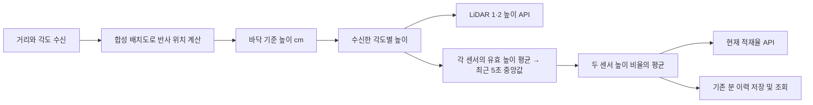

# 시뮬레이션 높이를 기존 모니터링 API로 제공

개발 환경에서 시뮬레이터의 거리·각도와 명시적으로 등록한 합성 배치도를 사용해 높이를 계산한다. 현장 보정 완료나 엣지의 정제 높이 수신을 의미하지 않는다. 엣지가 최종 높이를 제공하는 계약은 별도로 연결한다.

## 화면 담당자가 연결할 API

API 주소와 기존 높이·적재율 필드를 그대로 사용한다. 대시보드에서 높이나 중앙값을 다시 계산하지 않는다.

| 화면 | 요청 | 숫자 필드 | 구분 표시 |
| --- | --- | --- | --- |
| 현재 상태 | `GET /api/v2/monitoring/snapshot?pit_id=...` | `summary.loadPercent` | `summary.simulated`, `fillObservation.time_basis` |
| 실시간 상태 | `GET /api/v2/monitoring/events?pit_id=...` | SSE snapshot의 같은 필드 | 같은 출처 표시 |
| 최근 24시간 적재율 | `GET /api/v2/monitoring/load-history?pit_id=...` | `samples[].valuePercent` | `samples[].simulated`, `methodVersion` |
| LiDAR 1·2 높이 | `GET /api/v2/monitoring/profiles?pit_id=...` | `profiles[].samples[].height` | `sensorId`, `simulated`, `calibrationState`, `timeBasis` |

최근 24시간 이력은 from/to를 생략하면 기본 구간으로 조회한다. 센서 이름은 설치 설정에 맞춰 sensorId로 매핑한다. 배열 순서에 의존하지 않는다. 세 API 모두 로그인 세션이 필요하다.

- `simulated=true`이면 화면에 **시뮬레이션**을 표시한다. 일반 입력은 기본 false다.
- 높이는 cm, 적재율은 %다. `positionRatio`는 A→B 단면 위치 0..1이다. `sectionLengthCm`은 A~B 길이, `referenceDepthCm`은 비율 계산에 사용한 합성 깊이다.
- `calibrationState=SIMULATION`은 현장 검증을 의미하지 않는다. 원래 센서의 calibration/transform/capabilities는 그대로 유지한다.
- `timeBasis=SIMULATION_SOURCE_UTC_UNVERIFIED` 및 fillObservation의 같은 의미 `time_basis`는 원래 관측 UTC의 동기화를 검증하지 않았다는 뜻이다. 시각을 서버 수신 시각으로 바꾸거나 SYNCED로 꾸미지 않는다.
- `dataState=FRESH`여도 위 시뮬레이션·시각 표시를 함께 사용한다. FRESH는 설정된 시간 범위 내에 있다는 의미다.
- 값 null 또는 valid=false인 구간은 선을 끊는다. 실제 0cm/0%는 그대로 표시한다. 준비 중·센서 단절·관측 지연 시 과거 값을 대신 보여주지 않는다.
- 기본 `valuePolicy=SENSOR_ANGLE`의 height는 최신 수신 측정점의 높이다. 그래프를 표시하기 위해 시간 창이 준비될 때까지 기다리지 않는다. 원래 각도는 `samples[].angleMdeg`(1/1000도), 원래 배열 식별자는 `sourceIndex`로 제공한다. `positionRatio`는 현재 반사점의 A~B 위치이며 값이 잘못된 점에서는 null이다. 별도 중앙값 전용 필드로 갈아타지 않는다.
- `samples`의 개수는 수신 측정점 수이며 20개로 고정하지 않는다. 각도·원본 index 오름차순이고 공간 위치가 반드시 오름차순이라는 뜻은 아니다. 각도 그래프는 angleMdeg를 x축으로, 공간 그래프는 유효한 positionRatio를 사용한다. null 위치·높이는 연결하지 않는다. API는 원래 각도 선택 범위 밖의 가상 측정점을 추가하지 않는다.
- 이력의 시각·ID가 null이어도 유효한 분 집계 숫자는 bucket 위치에 표시할 수 있다. [부분 구간 정책](DASHBOARD_API_GUIDE.md#분-이력과-부분-구간)을 따른다.

## 계산·저장 흐름

각 점의 방향은 `direction0*cos(각도) + direction90*sin(각도)`, 위치는 `origin_cm + 거리_cm*방향`이다. z에서 바닥 z를 빼 높이를 구한다. 스캔 평면과 바닥의 교선 중 경계 내부에서 가장 긴 연속 구간을 A~B로 사용한다. 따라서 레이저의 비스듬한 거리를 높이로 그대로 표시하지 않는다.

기본 `sampling_policy=SENSOR_ANGLE`에서는 수신한 점을 임의의 공간 구간으로 묶지 않는다. 각 측정점에서 높이를 구해 최신 `samples`로 제공한다. 20칸, 구간별 최소 점 수, 최소 측정 비율 조건은 적용하지 않는다. 유효한 측정점이 하나라도 있으면 그 높이를 제공한다. 원본 시각·각도·index를 그대로 유지한다.

현재 적재율의 대표값은 각 센서의 스캔에서 유효 높이 평균을 구하고, 최근 서로 다른 5초 평균값의 중앙값을 구한다. 두 센서의 대표 높이를 각각 합성 깊이로 나눈 비율을 같은 비중으로 평균한다. 점 개수나 각도 배열이 바뀌어도 같은 센서의 스캔 평균 창을 이어간다. 같은 각도·다른 index의 측정점은 그래프에서 합치지 않는다.

`average/minimum/maximum`은 최신 유효 측정점의 통계다. `filteredAverage`는 시간 중앙값이 준비된 대표 높이 cm이며, 준비 전에는 null이다. `summaryValuePolicy=SCAN_MEAN_TEMPORAL_MEDIAN`이면 `sectionFillPercent`는 filteredAverage / referenceDepthCm × 100이다. 그래프의 개별 height를 시간 중앙값 결과로 설명하지 않는다. `EDGE_V2_HEIGHT_MEDIAN_ENABLED`와 `EDGE_V2_HEIGHT_FILL_ENABLED`가 모두 꺼져 있으면 `summaryValuePolicy=PROFILE_MEAN`이며 sectionFillPercent는 최신 평균으로 구한다.

반복 스캔·중복 전송은 관측 개수를 늘리지 않는다. 시간 간격이 벌어지거나 장비 재시작·기준 설정 변경·센서 이상이 있으면 대표값 창을 다시 준비한다. 현재 스캔에 유효 높이가 하나도 없으면 과거 높이로 채우지 않는다. 시각 지연·미래 시각·설정 불일치도 계속 차단한다. 스캔당 최대 8192점까지 처리하며 초과하면 `HEIGHT_SAMPLE_LIMIT_EXCEEDED`로 전체 프로필을 사용할 수 없게 한다. 이는 자원 상한이며 최소 측정 개수 조건이 아니다. 일부 점을 조용히 잘라 제공하지 않는다.

`coverageBasis=RECEIVED_POINTS`의 coverageRatio는 유효 높이 개수 / 수신한 전체 측정점 개수이며 **진단 정보로만 제공한다. 이 비중으로 표시나 적재율 계산을 차단하지 않는다.** 수신하지 않은 공간이나 각도를 분모에 추가하지 않는다. 이것은 공간 면적의 관측률을 뜻하지 않는다. 0거리·경계 밖 등의 잘못된 측정점은 height=null/valid=false로 남기며 다른 유효 점을 숨기지 않는다. 한 센서에 유효 높이가 없거나 두 센서 짝이 맞지 않으면 두 센서의 전체 비율은 null이다.

측정점 평균은 점이 밀집한 공간의 비중이 높다. 기존 같은 폭 공간 구간 평균과 숫자의 의미가 다르며, 전체 피트 부피나 전체 A~B 공간의 충전 비율을 검증한 값이 아니다. 합성 깊이는 `top_z_cm-floor_z_cm`이며 기존 관리자의 피트 깊이 설정을 덮어쓰지 않는다.

기존 `sampling_policy=SPATIAL_BIN`을 명시하면 공간 구간 중앙값과 minimum_coverage 경로를 사용할 수 있다. 일반 검증 보정 좌표 경로의 공간 구간 정책도 유지한다. 수신점 기본 모드에서는 bin_count, minimum_points_per_bin, minimum_coverage를 사용하지 않는다.

0 이하 거리, 위쪽 광선, 경계 밖/높이 범위 밖, 벽 가까운 점을 제외한다. 원래 position_mm 및 좌표 계산 사유는 원문 그대로 두고 이 계산에 사용하지 않는다. SDK 품질 기준은 설정했을 때만 적용한다.

DB 테이블 추가는 없다. 기존 compact 구조에서 최신 수신 원문과 제한된 높이 창(각도 모드 센서당 1개 평균 × 최대 31초 × 2센서; 일반 공간 모드 최대 200구간 × 31초 × 2센서), 분당 최대 60개의 숫자 슬롯을 유지한다. 매번 모든 원시 점을 새 이력으로 누적하지 않는다. 각도 모드 계산 방법은 `SIMULATION_SENSOR_ANGLE_V1:<digest>`, 기존 공간 모드는 `SIMULATION_HEIGHT_SECTION_V1:<digest>`로 기록한다. 변경된 기준은 필터 창을 새로 준비하며 이전 공간 평균 이력을 다시 계산하지 않는다. 다른 계산 기준의 유효 값이 한 조회 bucket에 섞이면 MIXED/null로 반환한다. 시뮬레이션 기록은 설정을 꺼도 simulated 표시를 유지한다. 이력 bucket에 시뮬레이션 관측이 하나라도 포함되면 simulated=true이며, 결측 관측만 포함된 경우에도 출처를 숨기지 않는다.

## 백엔드 개발 환경 설정

기본은 비활성이다. private 환경 설정에 다음을 명시한다.

- `APP_ENV=development` 또는 `test`. production에서 시뮬레이션 기준을 설정하면 시작을 거부한다.
- `EDGE_V2_COMPACT_STORAGE_ENABLED=true`와 기존 장치·피트 연결 설정.
- `EDGE_V2_SIMULATION_HEIGHT_REFERENCES`: 아래 스키마의 JSON 배열. 동일 피트의 일반 HEIGHT_REFERENCES와 중복 등록하지 않는다.
- `EDGE_V2_HEIGHT_MEDIAN_ENABLED=true`: 수신점 모드는 대표 스캔 평균의 시간 중앙값, 공간 모드는 구간 높이의 시간 중앙값 제공.
- `EDGE_V2_HEIGHT_FILL_ENABLED=true`: 현재 게이지·분 이력에도 높이 비율 연결. 이 설정 자체로 외부 수거 알림을 보내지 않는다.

| 기준 필드 | 의미 |
| --- | --- |
| pit_id / config_revision / coordinate_frame_id | 조회 피트와 수신 설정·좌표계 연결을 고정 |
| environment_id / simulator_revision | 확인한 합성 환경 식별자와 실행 소스의 40자리 revision |
| floor_z_cm / top_z_cm | 합성 바닥·상한 높이, 양수 깊이 필요 |
| boundary_xy_cm | 3~64개 꼭짓점의 단순 다각형, cm |
| sensor_poses | 등록된 두 센서 ID 각각의 origin_cm, direction0, direction90 |
| sampling_policy | 기본 SENSOR_ANGLE; SPATIAL_BIN은 명시적 기존 방식 |
| bin_count / minimum_points_per_bin | SPATIAL_BIN에서만 적용, 기본 20구간 / 구간당 3점 |
| minimum_coverage | SPATIAL_BIN에서만 적용, 기본 1.0; SENSOR_ANGLE에서는 표시 조건으로 사용하지 않음 |
| wall_margin_cm / minimum_quality | 기본 벽 여백 5cm / 품질 임계값 없음 |

origin은 cm, 두 방향 벡터는 서로 수직인 단위 벡터다. 실제 배포 전 실행 이미지 revision, 실제 환경 파일, 두 드라이버와 합성 센서의 대응을 운영자가 읽기 전용으로 확인한다. 원시 수신 계약에 simulator revision이 없으므로 백엔드가 송신 시점의 이미지 동일성을 자동 증명하는 기능은 아니다. 합성 설정이나 내부 주소를 공개 저장소에 복사하지 않는다.

이 별도 모드에서는 SYNCED 또는 UNSYNCED인 원래 UTC를 사용하되, 미래·오래된 스캔·상태, 설정 불일치, 센서 단절을 계속 차단한다. 다른 clock 상태는 차단한다. 일반 높이 경로의 VERIFIED 보정 및 SYNCED 요구는 유지한다.

운영 판정도 별도로 켠 개발 시험에서는 기존 3단계·복귀 여유·연속 확인·쿨다운을 재사용한다. 기록은 LOG/RECORDED이며 시뮬레이션 경보 제목과 v2 simulated 필드로 구분한다. 외부 발송 성공을 의미하지 않는다.

## 검증과 적용

`tests/test_sensor_angle_height.py`는 수신점 개수, 고적재 상태, 스캔 평균의 시간 중앙값, 비율·최소 개수 조건 제거, 최신 그래프 유지, 800점 API·센서당 숫자 하나인 창, 0/잘못된 값·중복 각도·최대점 제한과 이력 출처를 검증한다. `tests/test_simulation_height.py`는 공개 가능한 가상 상자로 높이·0값·결측·이상 거리·설정·시각·중앙값·기존 API·이력·로그 출처를 검증한다. 기존 검증 보정 경로는 기존 회귀 검사도 유지한다. 실제 PostgreSQL 검사는 별도 임시 DB에서 수행한다.

코드 병합과 서버에서 private 설정을 활성화하는 단계는 구분한다. 작업 브랜치가 있다는 이유로 현재 서버에서 이미 높이가 제공된다고 설명하지 않는다. 화면 담당자는 위 API 조회와 필드 매핑을 연결하며, 백엔드 저장소에서 대시보드 코드를 변경하지 않는다.
